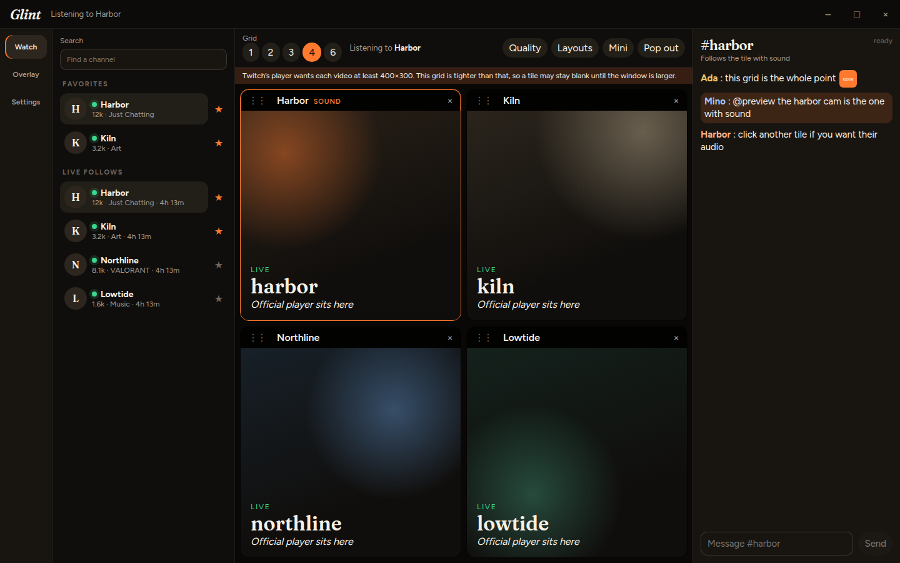
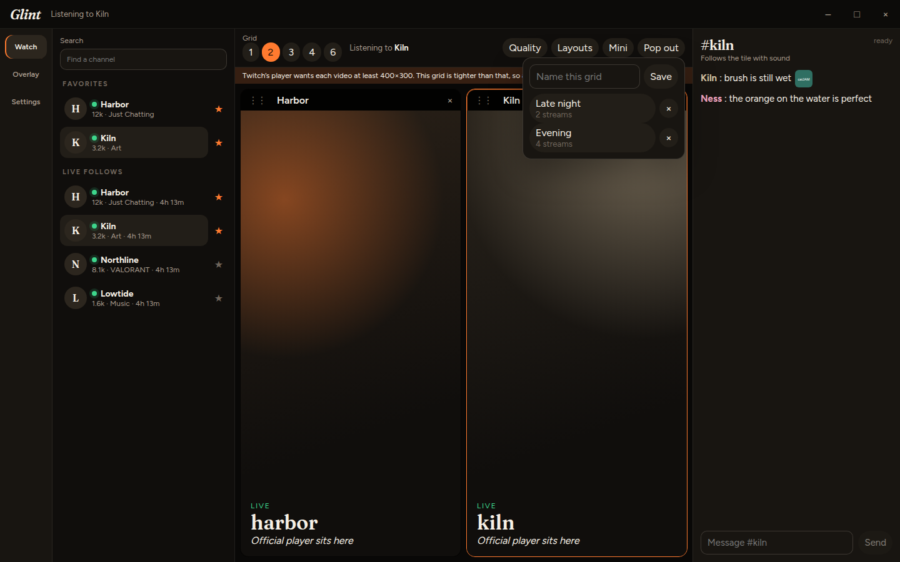
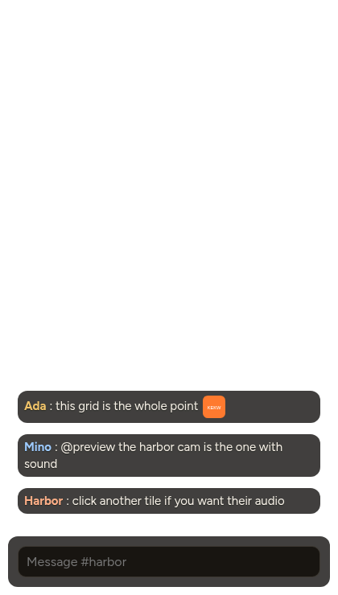

# Glint

Glint is a small Windows app for watching Twitch. The first screen is a **multi-view grid**: two, three, four, or six official players at once. Audio follows the tile you click, you can drag tiles into a new order, and you can save that arrangement. Chat on the right is the chat of the tile that has sound.

It also signs you in with Twitch's device-code flow, lists the follows that are live, keeps a favorites list, and sits in the system tray so it can toast you when a favorite goes live. Chat includes Twitch emotes plus 7TV, BetterTTV, and FrankerFaceZ. A transparent always-on-top overlay can float that same chat over a game.



## Why Tauri

The shell is [Tauri 2](https://v2.tauri.app/) with a React interface. A tray app that starts with Windows should not ship a second copy of Chromium. Tauri uses the WebView2 runtime Windows 10 and 11 already have, so the installer stays small. Tauri 2 also covers the desktop pieces this app needs: a system tray, native toasts, transparent always-on-top windows, global hotkeys, and autostart. The Rust side is deliberately thin. It stores the OAuth token in Windows Credential Manager, proxies HTTPS to an allowlist of hosts, and holds the one IRC socket and the one EventSub socket. Parsing, emotes, the live-alert diff, and the multi-view layout live in TypeScript and are unit tested.

## What the Twitch rules changed

Glint only uses documented Twitch surfaces:

- OAuth device-code grant for a **public** client. Twitch's own guide says a public client on an open platform such as Windows should use this flow, and that a public client does not use the other grants. There is no client secret in the app, in CI, or in this repo.
- Helix for the signed-in user, followed live streams, avatars, and channel search.
- EventSub over its WebSocket transport for `stream.online` on favorites (capped at 40, which is Twitch's cost-friendly set for one socket).
- Chat over Twitch IRC on `wss://irc-ws.chat.twitch.tv`. EventSub chat only works for the broadcaster or a moderator of that channel, so it cannot be the general chat client.
- Video through the official interactive embed (`player.twitch.tv/js/embed/v1.js`). If that script fails to load, the tile falls back to the official iframe. There is no playlist scraping, no ad blocking, and no private or unofficial Twitch endpoint.

Those choices show up in the player:

- Quality uses `getQualities` and `setQuality`. If the embed has not reported qualities yet, use the gear menu inside the player. That menu is the same official control.
- The Windows release is served from `https://tauri.localhost` (`useHttpsScheme`). Twitch refuses to frame `http://tauri.localhost`. The embed `parent` list is the page host plus `tauri.localhost` and `localhost`. Dev stays on `http://localhost`, which Twitch allows. Chat is IRC, not the Twitch chat iframe.
- There is **no low-latency toggle**. The embed does not expose one. When `getPlaybackStats()` returns `hlsLatencyBroadcaster`, Glint shows that number. It does not change latency.
- Twitch requires each embed to be at least 400×300. Popout and mini windows respect that. A 4-up or 6-up grid on a small window can fall under it, and a tile may stay blank until you enlarge the window or pop that stream out. The grid says so when it happens.
- Third-party emotes come from the public 7TV, BetterTTV, and FrankerFaceZ HTTP APIs. Zero-width 7TV overlays are not drawn yet.

The Client ID is yours. Put it in the first-run screen. It is stored in Glint's settings file on your machine, not in the repository. The access token and refresh token are stored in Windows Credential Manager (the OS credential store on other platforms) and are not written to localStorage.

## Multi-view

This is the core of the app, not a later extra.

- The grid switcher is **1, 2, 3, 4, or 6** streams. Three-up keeps one large tile and two stacked beside it.
- Only the focused tile is unmuted. Click a tile once and the sound moves there. The other players stay muted.
- Drag a tile by the grip in its header, or drag a channel from the list onto a slot.
- Clicking a channel fills the first empty slot, or replaces the focused one when the grid is full. Clicking a channel that is already on the grid just gives it sound.
- **Layouts** saves the current grid by name (up to 12) and restores it. The last arrangement is also restored the next time you open Glint.
- The chat column, and the overlay, follow the focused stream.

## Also in this version

- Device-code sign-in, then a list of live follows and a favorites list.
- Tray icon. Closing the window hides Glint; quit is in the tray or in Settings. The tray lists live favorites.
- A toast when a favorite goes live. You can switch that to every follow, or off. The first refresh does not toast everyone who is already live.
- Popout player and a pinned mini player, both at least 400×300.
- Chat with Twitch, 7TV, BTTV, and FFZ emotes, mention highlighting, and a word filter.
- Transparent, always-on-top chat overlay. Ctrl+Alt+G shows or hides it. The **×** in the corner closes it, including while click-through is on, and Escape closes it when the overlay is focused.
- Ember and Dusk themes, start-with-Windows (launches minimized to the tray), and a test toast button.

## Not in this version

These are the follow-on phases. They stay on the official API; they are just not built yet.

1. **Watch more.** A VOD browser (`Get Videos`) and playback through the embed's `video` parameter, a clip browser (`Get Clips`) with the clips embed, and a category browser (`Get Top Games` and `Get Streams`).
2. **Streamer tools.** Stats for your own channel (viewers, followers, uptime), an alerts overlay for follows, subs, cheers, and raids, and a small chat bot for commands and timers. Those EventSub types require the broadcaster's token and extra scopes, and the bot has to respect Twitch's chat rate limits.
3. **Chat depth.** Badge images, zero-width 7TV emotes, replies as threads, and more than one signed-in account.

## Screenshots

The shots below are the real interface with demo channels, so they do not depend on a Twitch login. After you sign in, each tile is the official player instead of the preview card.






## Set up your Twitch application

Glint cannot ship a shared Client ID. Register one for yourself. It takes a few minutes and needs no client secret.

1. Open the [Twitch developer console](https://dev.twitch.tv/console/apps) and sign in.
2. Choose **Register Your Application**.
3. Use these values:
   - **Name:** Glint (or any name you like)
   - **OAuth Redirect URLs:** `http://localhost:3000`
   - **Category:** Application Integration
   - **Client Type:** Public
4. Create the application.
5. Copy the **Client ID**. Leave the client secret where it is. Glint never asks for it.

The redirect URL is required by the console. The device-code flow does not open it, and Glint does not listen on that port. Twitch documents this flow for public clients and recommends a public client on Windows. A confidential client is the wrong type here because it expects a secret.

When you sign in, Glint requests these scopes and no others:

| Scope | Why |
| --- | --- |
| `user:read:follows` | List the live channels you follow |
| `chat:read` | Read chat over IRC |
| `chat:edit` | Send chat messages |

## Install and run

On a current Windows 10 or 11 machine:

1. Download `Glint_*_x64-setup.exe` from the GitHub release for a tagged version, or from the `glint-windows` artifact on a successful CI run.
2. Run the installer. If WebView2 is missing, the installer can download it. You do not need Node or Rust.
3. Launch Glint.
4. Paste the Client ID and choose **Save client ID**.
5. Choose **Sign in with Twitch**. Open the verification page, approve the three scopes, and wait for the window to pick up the login. Twitch shows the code; you do not type it into Glint.
6. Star the channels you want toasted, then click live channels to fill the grid. Click a tile to give it audio. Drag the grip to rearrange. **Layouts** saves the arrangement.

Closing the window leaves Glint in the tray. **Quit Glint** is in the tray menu and in Settings.

The main window is borderless but opaque, with the Windows shadow turned off. A transparent shadow on that kind of window makes the whole desktop feel laggy on some GPUs, and it used to start the moment the setup screen appeared. The chat overlay is not created until you are signed in and open it. Its hotkey is off until you turn it on in Settings.

### If Windows feels slow

Quit Glint from the tray, then start it with `glint.exe --safe-mode`, or hold Shift while you open it. Safe mode keeps the overlay closed, shows one tile, and does not play video until you click it.

The startup log is written to `%APPDATA%\app.glint.desktop\glint.log`. The setup screen shows that path. Send that file with the next report.

`glint.exe` from the same artifact is a portable build. It still needs WebView2, which updated Windows 10 and 11 already include. The NSIS installer is the one to hand to someone else.

The Client ID stays in Glint's settings file under your user profile. Tokens stay in Credential Manager under the service name `app.glint.desktop`.

## Build from source

You need Node.js 22, Rust 1.100 (the `rust-toolchain.toml` in this repo pins it), and the WebView2 runtime. Nothing has to be installed on a particular machine beyond that: GitHub Actions builds the installer on `windows-latest`.

```bash
npm ci
npm test
npm run tauri build
```

The installer is written to `src-tauri/target/release/bundle/nsis/`. The portable exe is `src-tauri/target/release/glint.exe`.

For day-to-day work:

```bash
npm run tauri dev
```

`npm run dev` serves the interface in a browser. Add `?demo=1` to walk the multi-view layout without a Client ID. Sign-in, the tray, and real video only exist inside the Tauri window.

Useful scripts:

| Script | What it does |
| --- | --- |
| `npm test` | Unit tests for auth, emotes, IRC, EventSub, Helix parsing, and the multi-view layout |
| `npm run lint` | Biome |
| `npm run typecheck` | `tsc --noEmit` |
| `npm run tauri build` | Frontend, Rust release build, and the NSIS installer |

## Development notes

Network calls from the webview go through Rust. The proxy allows only `https://id.twitch.tv`, `https://api.twitch.tv`, and the public emote APIs. Authorization headers are stripped before a request can leave for an emote host. EventSub reconnects are accepted only for `wss://eventsub.wss.twitch.tv`.

Refresh tokens from the device-code flow are single-use and expire after 30 days of inactivity. Glint rotates the stored refresh token on each refresh. When Twitch rejects it, you sign in again.

Favorites are the channels that get an EventSub `stream.online` subscription and, by default, a toast. A periodic Helix check of followed streams is the list you see, and it catches a live event if the socket blips. Toasts are deduped by the stream's `started_at`, so a restart does not re-toast a broadcast you already saw.

## License

[MIT](LICENSE). Copyright (c) 2026 Zeke.
